# 环信 Vue3 UIKit：30 分钟，给你的应用装上完整的 IM

> 如果你正在用 Vue 3 开发一个需要聊天能力的应用——不管是客服系统、社交产品、企业 OA 还是直播互动——这篇文章想告诉你一件事：**IM 界面这层，你真的不用自己写。**
>
> 环信 Vue3 UIKit（`@easemob/uikit-im`）是基于 `easemob-websdk`（SDK5）构建的 Vue 3 UI 组件库。它把「会话列表、聊天页、通讯录、群管理、消息收发、已读回执、主题、H5 适配」这些每个 IM 产品都要重做一遍的东西，做成了一套开箱即用的组件。本文所有截图都来自仓库自带 demo 的真实运行画面，没有任何 PS。

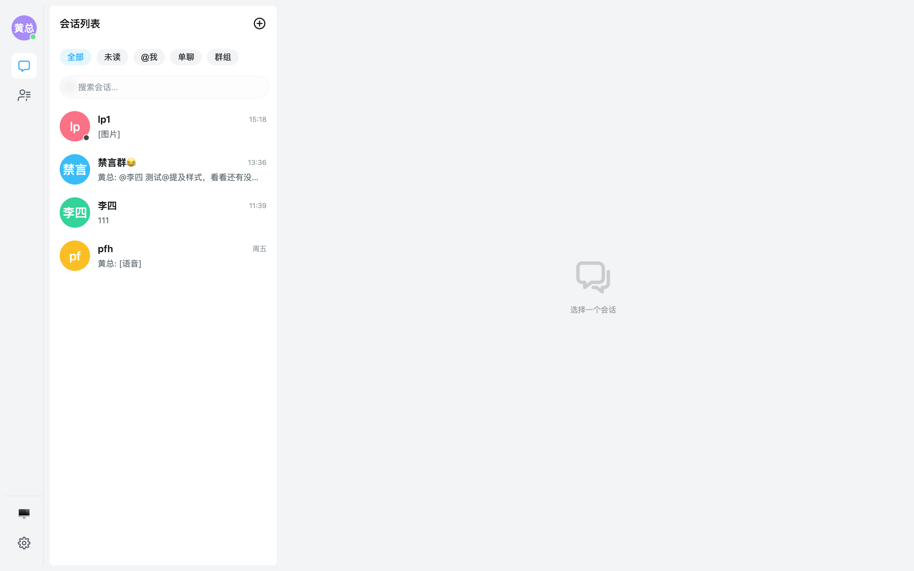

---

## 一、接入有多简单？三行代码起步

```ts
// main.ts
import { createApp } from 'vue'
import { createPinia } from 'pinia'
import UIKit from '@easemob/uikit-im'
import '@easemob/uikit-im/websdk5' // 注册 SDK 适配器
import '@easemob/uikit-im/theme'   // 引入主题样式

const app = createApp(App)
app.use(createPinia())
app.use(UIKit)
app.mount('#app')
```

然后在页面里放一个容器组件，一个完整的聊天应用就立起来了：

```vue
<template>
  <EmUIKitProvider app-key="your-app-key" :auto-init="true" enable-contact enable-presence>
    <EmConversationContainer />
    <EmChatContainer />
  </EmUIKitProvider>
</template>
```

对比一下自研的成本：会话列表的未读数与置顶排序、消息气泡的十几种状态、历史消息的分页加载与滚动锚定、断线重连后的数据恢复……每一项都是以「周」为单位的工程量，而在这里它们是默认值。

## 二、开箱即用的完整聊天体验

### 会话列表：不只是个列表

`EmConversationContainer` 自带你可能需要的一切：**分栏筛选（全部 / 未读 / @我 / 单聊 / 群组）、会话搜索、未读徽标、置顶、免打扰、草稿提示、下拉刷新**，每一项都可以通过 props 开关或定制。

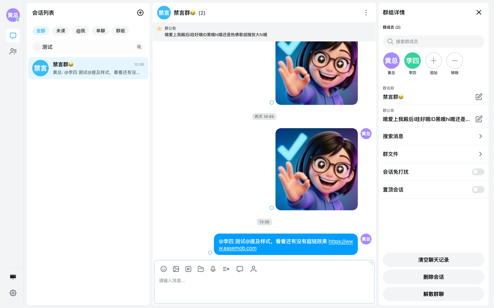

### 聊天页：消息能力全家福

`EmChatContainer` 是真正的重头戏。消息类型覆盖 **文本、图片（三级预览）、语音（含语音转文字）、视频、文件、位置、合并转发、自定义消息**；消息交互覆盖 **引用、复制、转发（单条/逐条/合并三种模式）、多选、编辑、撤回（群主可撤回他人消息）、置顶、翻译、删除（含服务端漫游删除）**——右键或长按气泡，操作菜单就在那里：

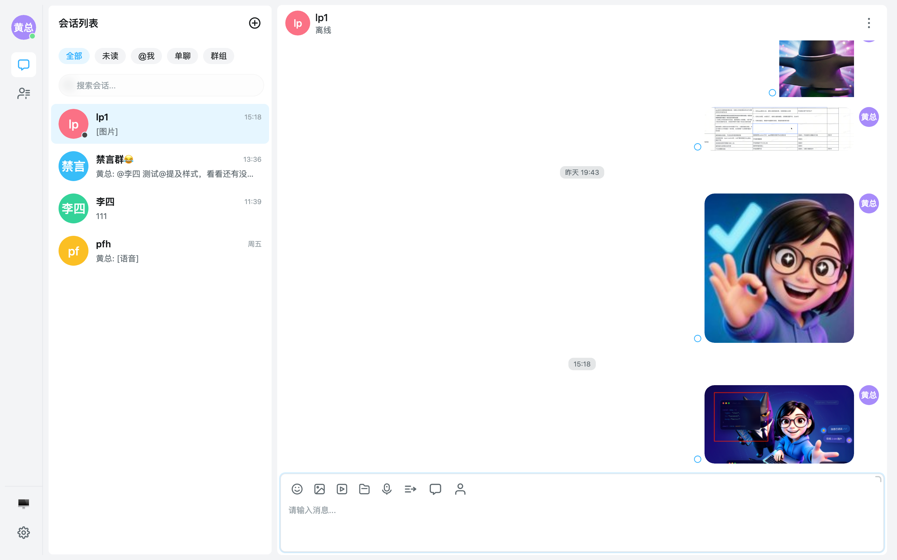

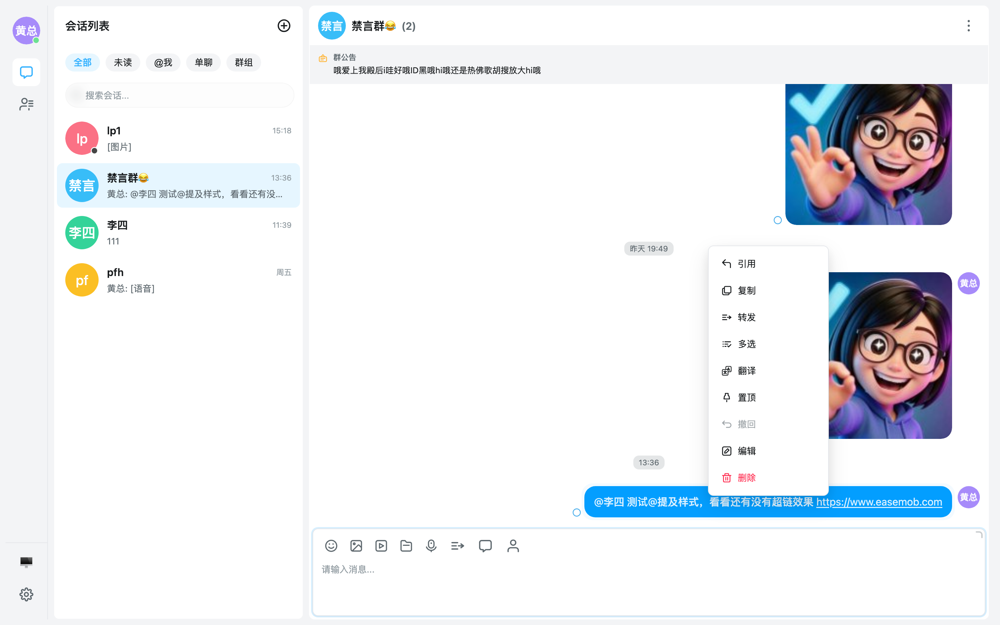

转发有现成的会话选择弹窗：

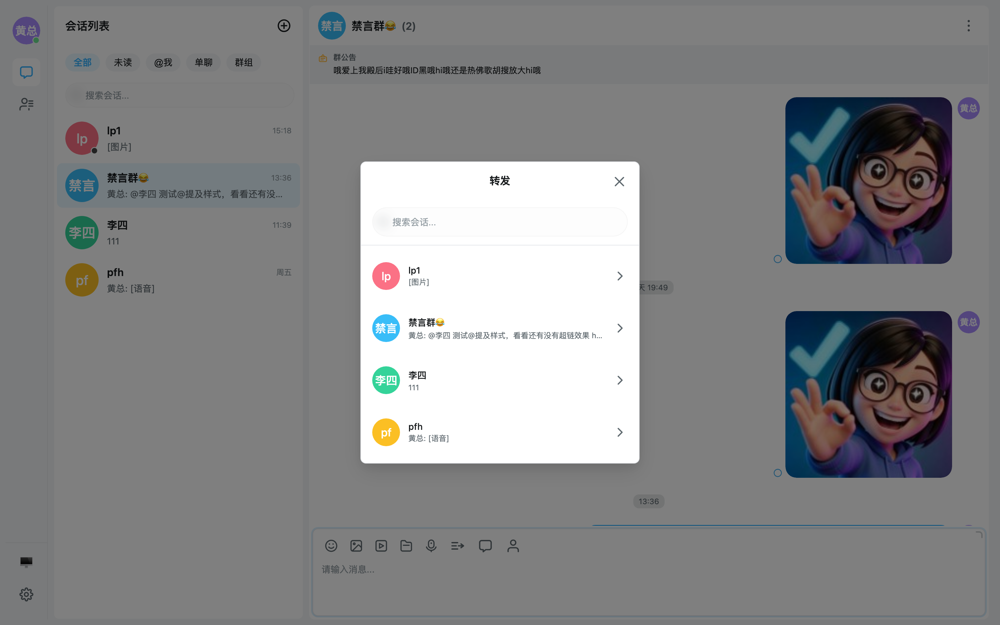

群聊场景下，@提及高亮、群公告横幅、超链识别都是默认行为：

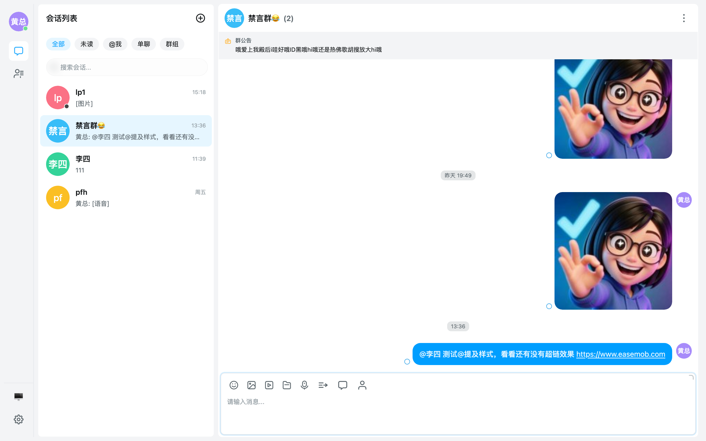

会话内**消息搜索**支持关键词高亮与按类型（文本/图片/视频/文件/位置）筛选：

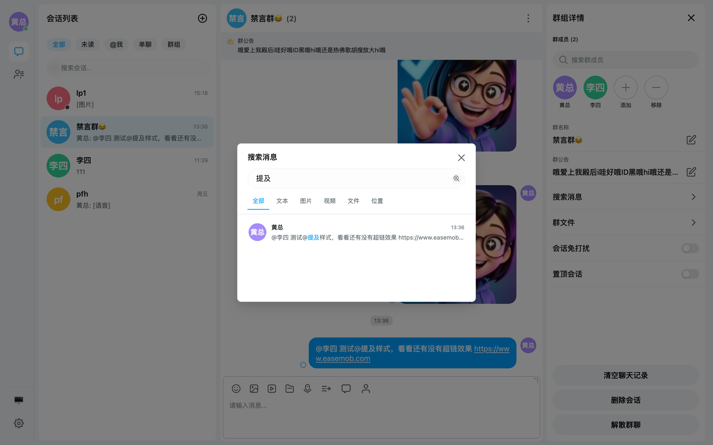

还有一些「用了才知道香」的细节：截图后 **Cmd/Ctrl+V 粘贴图片会弹出预览确认框**再发送；己发图片回填远程地址前会先预载、**不闪白屏**；单聊已读回执、群已读人数与已读详情弹窗一应俱全，且全局 `enableReadReceipt` 一个开关即可整体关闭已读能力。

### 通讯录与群管理

`EmContactContainer` 提供好友列表（字母索引导航）、群组列表、新请求、黑名单的完整多视图：

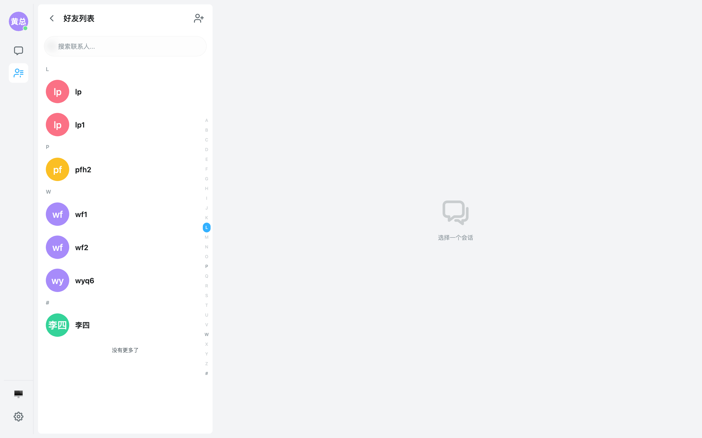

点进任意群聊的详情抽屉，**成员管理（添加/移除）、群名称、群公告、消息搜索、群文件、免打扰、置顶、清空记录、解散群聊**全部内置：

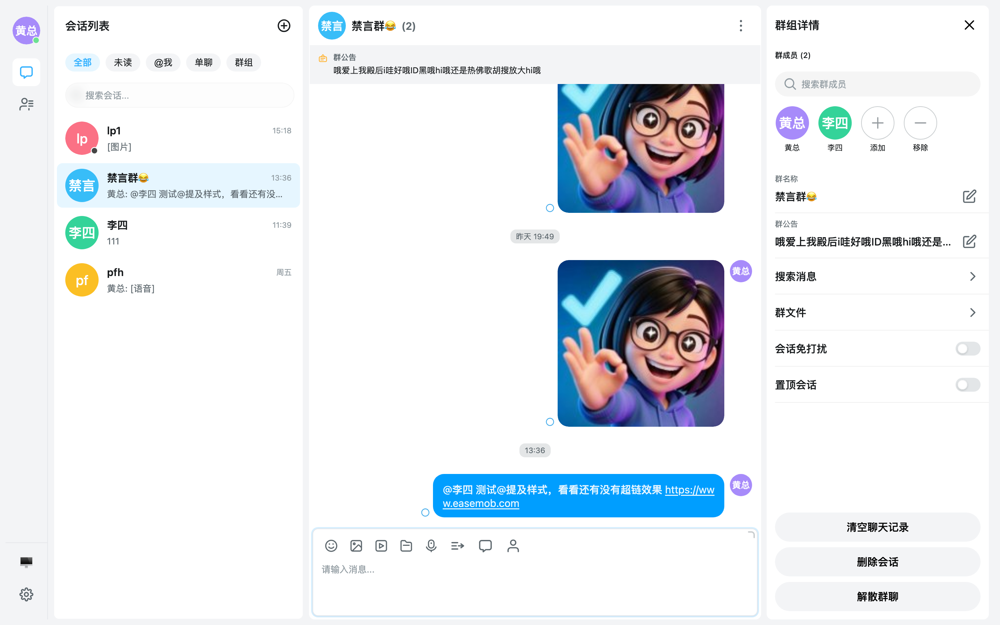

点击头像弹出名片，昵称、用户 ID、个性签名、在线状态自动装配：

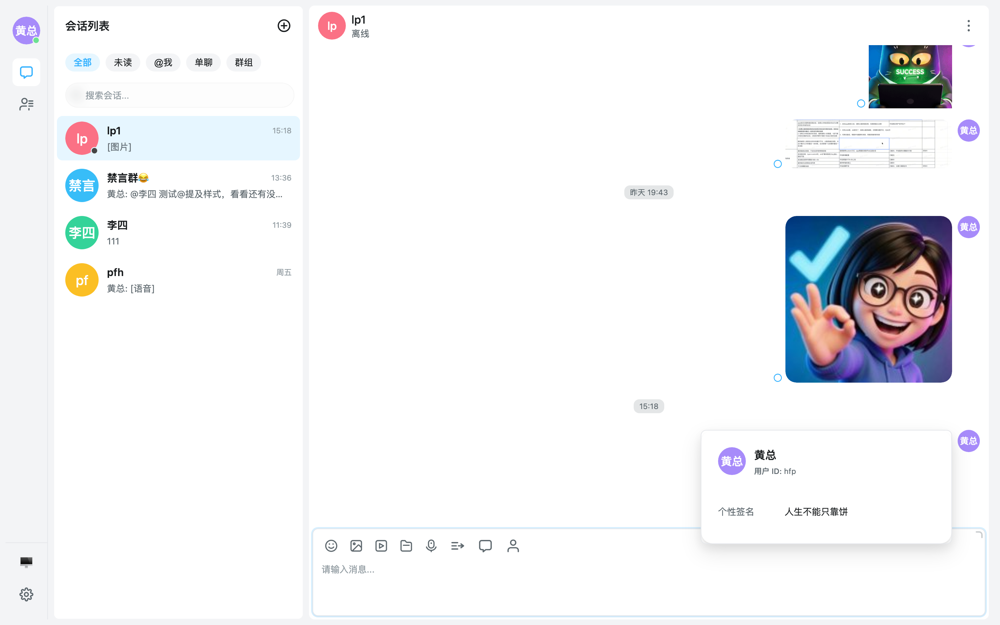

## 三、主题定制：一个数字，换一整套皮肤

UIKit 的主题系统建立在完整的 `--uikit-*` CSS 变量 token 体系之上，通过 `theme` prop 或 `useTheme()` 即可控制：

```vue
<EmUIKitProvider
  :theme="{
    preset: 'default',        // default / business / fresh 预设
    mode: 'dark',             // light / dark / auto 跟随系统
    primaryColor: 150,        // 主色色相：改一个数字，全局换肤
    fontSize: 'large',        // 字号档位（适老化友好）
    density: 'compact',       // 密度：compact / normal / comfortable
    avatarShape: 'square',    // 头像形状全局统一
    chatBg: 'linear-gradient(...)', // 聊天背景支持渐变/图片
  }"
>
```

暗色模式是真·全局适配，不是简单反色：

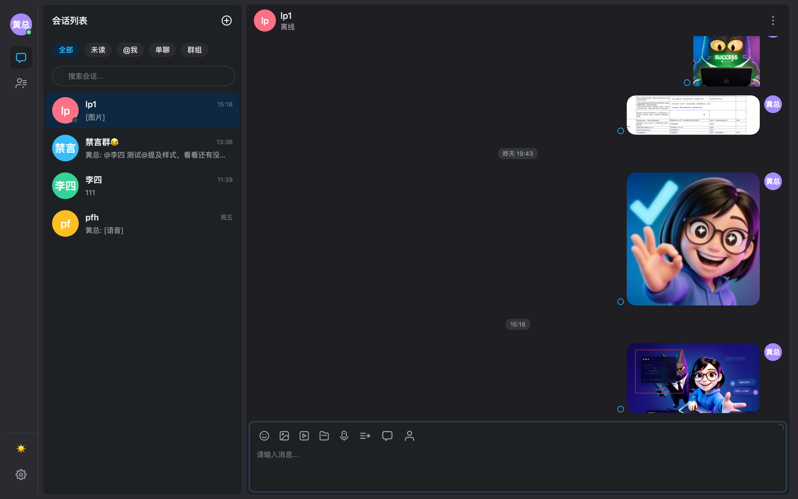

主色色相改一个数字，选中态、按钮、链接、气泡整套色彩语义联动：

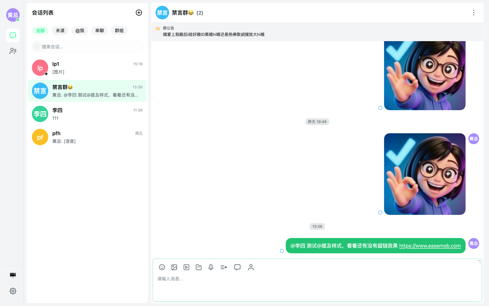

demo 里内置了一个实时主题调试面板，所有主题参数的效果即调即见——这也是你接入后可以自己玩的东西：

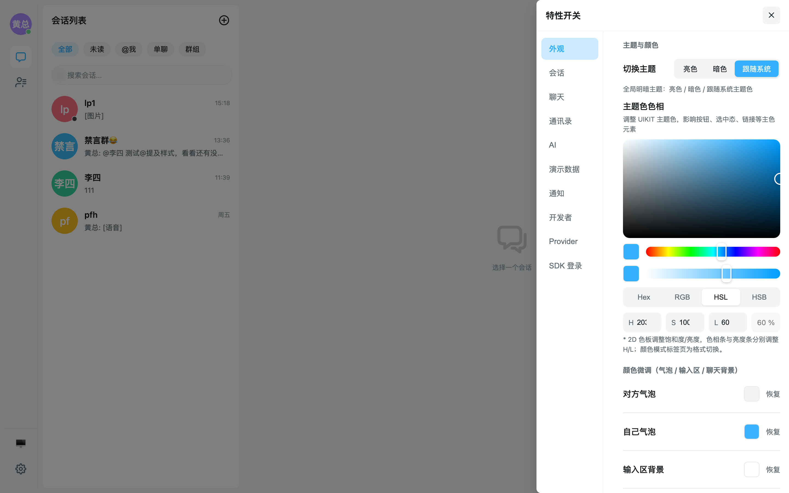

## 四、H5：一个 prop，PC 移动端通吃

同一套代码，在移动端视口自动切换为单栏栈式导航：

| 移动端会话列表 | 移动端聊天页 |
| --- | --- |
| 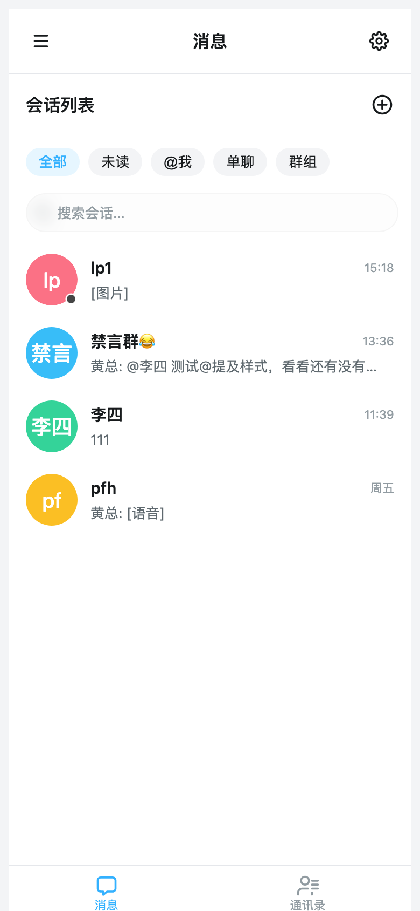 | 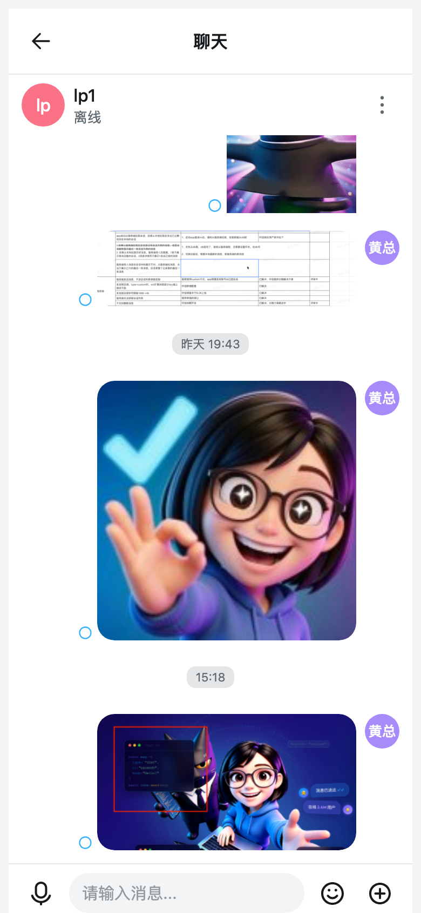 |

安全区、软键盘适配、下拉刷新、长按交互，通过 `h5` prop 一键开启：

```vue
<EmUIKitProvider :h5="{ safeArea: true, keyboardAdapt: true, pullRefresh: 'auto' }">
```

## 五、真正的杀手锏：扩展机制

开箱即用只是起点。UIKit 留了一整套**不改变源码就能深度定制**的扩展点：

- **插槽接管**：`#header`、`#notice`（聊天区通知条，比如防诈骗提示）、`#drawer`（整块会话详情抽屉）、`#user-card` / `#group-card`（名片弹窗）、`#message-custom`（自定义消息渲染）、`#watermark`（水印）……从一小块到整面板，粒度任选。
- **`useChatPlugin`**：在插槽组件里拿到聊天上下文（当前会话、当前用户）和全类型消息发送能力，写业务插件（快捷回复、AI 助手、商品卡片）不需要碰 UIKit 内部状态。
- **发送钩子**：`hooks.beforeSend / afterSend` 拦截或增强每一条外发消息。
- **会话分栏**：`useConversationTabs` 自定义 tabs，`#tabs` 插槽可整块接管。

demo 里就有现成的玩法示例：自定义名片消息、快捷回复面板、AI 流式消息演示、水印插槽，可以直接抄作业。

## 六、工程素质：给认真的人看的部分

- **TypeScript strict 全量覆盖**，所有组件 props/emits 有完整类型与 API 文档（文档站由源码自动生成）。
- **双 SDK 适配器架构**：`import '@easemob/uikit-im/websdk5'` 走 5.x；私有化部署换成 `import '@easemob/uikit-im/webim4'` 即可接 4.x——**UI 代码一行不改，产物物理隔离**（4.x 工程的 bundle 里搜不到任何 5.x 符号，已通过摇树验收）。
- **按需引入**：`unplugin-vue-components` + 官方 `EasemobUIKitResolver`，用哪个组件打包哪个。
- **功能开关化**：联系人、黑名单、在线状态、草稿、@我、正在输入、已读回执……每个能力都有 `features` 开关，运行时切换即时生效。
- **数据可插拔**：`dataSource` 允许业务方接管好友/黑名单/用户搜索等数据源，UIKit 的 UI 照跑。
- **i18n**：中英文内置，`mergeLocaleMessages` 支持覆盖任意文案。
- **通知系统**：页内弹窗 + 浏览器系统通知 + 免打扰 + 点击跳转会话。
- **可观测性**：分级日志 + IndexedDB 日志持久化 + SDK 日志捕获，排障不靠猜。

## 七、现在开始

```bash
pnpm add @easemob/uikit-im pinia vue
```

- 文档站（本地）：`pnpm -F @easemob/docs dev`
- 在线 demo（本地）：`pnpm dev:demo`

> **诚实声明**：UIKit 当前为 **Preview 预览版**（当前版本 uikit-im 3.7.9），API 在正式发布前可能调整，暂不建议直接用于生产环境。但我们非常欢迎你：
>
> 1. 跑起 demo，亲手点一遍本文截图里的每个功能；
> 2. 在你的测试项目里接入试试，感受「30 分钟到第一个会话页」的真实体验；
> 3. 把任何建议、疑问、吐槽提到 Issue / PR——每一条我们都会认真评估。
>
> 你的反馈，就是它走向正式版的路线图。

---

*本文所有截图均来自仓库 `apps/demo` 的真实运行环境（easemob-demo 测试环境），拍摄脚本见 `tmp/promo_shots.mjs`。*
